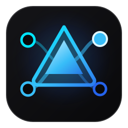
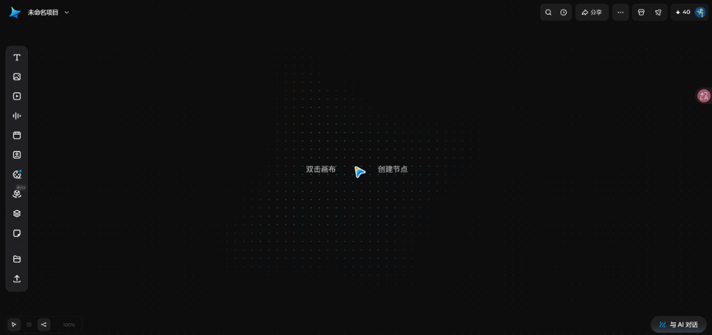

<div align="center">
  
  <h1>AI Canvas Studio</h1>
  <p><strong>即梦风格沉浸式 AI 无限画布创作工作台 · 支持 `.huabu` 配方分享、角色锁脸、分镜故事板与多模型生图生视频</strong></p>

  <p>
    <a href="https://github.com/Mon-Knight/AI-Canvas-Studio/releases/latest">
      
    </a>
    <a href="https://github.com/Mon-Knight/AI-Canvas-Studio/actions/workflows/ci.yml">
      
    </a>
    <a href="LICENSE">
      
    </a>
    
  </p>

  <p>
    <a href="https://github.com/Mon-Knight/AI-Canvas-Studio/releases/download/v0.9.0/AI-Canvas-Studio-v0.9.0-win64-setup.exe">
      <strong>📥 下载 Windows 安装版 Setup.exe (v0.9.0)</strong>
    </a>
    &nbsp;&nbsp;|&nbsp;&nbsp;
    <a href="https://github.com/Mon-Knight/AI-Canvas-Studio/releases/download/v0.9.0/AI-Canvas-Studio-v0.9.0-win64-portable.zip">
      <strong>📦 下载免安装绿色便携版 Portable.zip (v0.9.0)</strong>
    </a>
    &nbsp;&nbsp;|&nbsp;&nbsp;
    <a href="https://github.com/Mon-Knight/AI-Canvas-Studio/releases/latest">
      <strong>🔗 查看最新 Release 与更新日志</strong>
    </a>
  </p>
</div>

---

## 界面总览（Jimeng Obsidian UI）

<p align="center">
  
</p>

---

## 核心特性

- **无界沉浸画布（Jimeng Obsidian UI）**：纯黑灰毛玻璃悬浮岛设计、极光微点阵背景、双击画布空白处就地建点，支持多画布管理与自由拖拽连线。
- **创作配方一键分享（`.huabu` 工作流包）**：
  - 支持在右上角「`分享 / 导出`」或左上角项目菜单一键导出完整画布为单个 `.huabu` 文件（可选携带本地图片/视频素材或轻量纯参数模式），**自动剥离个人账号、Project ID、API Key 与聊天记录**，保护隐私不泄密。
  - 他人直接将 `.huabu` 文件**拖拽进空白或已有画布**，即可一键复现节点排布、提示词与模型参数，并在生成时自动将参考图跨项目同步上传至接收方的 Flow 项目。
- **开箱即用 · 3 套新手指引示例画布**：
  - 空白画布中心直接展示精选工作流卡片（**番剧角色锁脸与多镜续拍**、**真人短剧定妆锁脸与情绪运镜**、**核心产品锚定与商业广告大片**），一键铺开完整节点连线与标准参数。
- **画布内新版本自动提醒闭环**：
  - 自动检查 GitHub Releases 最新版本，在右上角温和提示「`✦ 新版 vX.Y.Z`」，支持直接跳转安装版/便携版下载与忽略指定版本。
- **全能创作节点与上下文工作流**：
  - **文本 → 图片 / 视频**：直接继承上游文本提示词出图/出视频；点击「`✨ AI 润色`」后强制人工检查确认（支持「`↩ 还原原词`」），不擅自扣积分提交。
  - **视频 → 视频 / 图片**：自动通过离屏 `<video> + <canvas>` 抽取上游视频尾帧（默认续接）或首帧参考，缓存在源节点上，实现连续分镜续拍与图生扩展。
  - **官方主体模板 & 自定义主体**：支持动漫二创、日系立绘、角色三视图、国漫 3D、真人影视定妆与萌宠道具模板及本地持久化自定义主体。
- **完整 Google Flow 模型目录与积分预估**：
  - **图片**：Nano Banana Pro / 2.1（可调思考深度）/ 2 Lite，支持 `1K / 2K / 4K` 重塑与 `1–4` 张输出。
  - **视频**：Veo 3.1（Lite / Fast / Quality / Ultra 零积分低优队列）与 Omni 1.1 / 1.2 Flash，统一开放 **3–15 秒**时长调节、清晰度选择及输出数量切换，自动同步账户余额并实时预估消耗积分。
- **单窗桌面端内置引擎与专属应用图标**：无需手动安装 Chrome 扩展，桌面客户端内置 Chromium Flow 会话与进程外 Win32 文件选择器，点击上传图片不卡死。

---

## 普通用户快速上手（免 Python / Node 环境）

1. 点击页面顶部下载按钮或前往 [GitHub Releases](https://github.com/Mon-Knight/AI-Canvas-Studio/releases/latest) 下载最新 Windows 发行包：
   - **推荐安装版**：`AI-Canvas-Studio-v*-win64-setup.exe`（免管理员权限安装到当前用户目录，带专属桌面图标快捷方式，数据保存在 `%APPDATA%\ai-canvas-studio\workspace-storage`）
   - **绿色便携版**：`AI-Canvas-Studio-v*-win64-portable.zip`（解压后双击 `AI-Canvas-Studio.exe` 启动，全部画布与缓存数据保存在同目录 `data/` 下，可整包迁移）
2. 启动后点击右上角账号区域，在内层窗口登录你自己的 Google Flow 账号并打开任意 Flow 项目即可自动完成配对绑定。
3. 新用户可直接在空画布中央点击任意「新手指引示例工作流」开局，或将他人分享的 `.huabu` 配方包拖入画布一键导入。
4. （可选）点击「更多 → AI 模型与提供商」，填写自己的 OpenAI 兼容或 Gemini 接口与密钥，即可开启「`✨ AI 润色`」与图像视觉反推能力。

> **隐私与合规说明**：本软件采用 **本地运行 + 用户自带账号（BYOA）** 架构，所有登录凭证、提示词、画布 SQLite 数据库与媒体文件均仅保存在用户本机，项目仓库与导出的 `.huabu` 配方包均不包含任何个人凭据。

---

## 开发者本地运行与打包

### 环境要求
- **Node.js**：`22+`
- **Python**：`3.10+`（建议在 `agent/.venv` 创建虚拟环境）

### 1. 初始化依赖
```powershell
# 后端 Python 环境
python -m venv agent\.venv
agent\.venv\Scripts\python.exe -m pip install -e "agent[dev]"

# 前端与桌面端
cd frontend && npm ci
cd ..\desktop && npm ci && npm run build
cd ..
```

### 2. 开发模式运行
- 前端静态构建：`cd frontend && npx vite build`
- 刷新桌面端图标资源（修改图标脚本后）：`agent\.venv\Scripts\python.exe scripts\generate-app-icon.py`
- Windows 一键静默启动桌面端：双击根目录 [启动画布.vbs](启动画布.vbs) 或运行 `start-desktop.cmd`
- 也可分开启动调试：`start.cmd --agent` 与 `start.cmd --frontend`

### 3. 本地打包 Windows 免环境发行版
安装 PyInstaller 后，运行一体化打包脚本即可生成 `release/AI-Canvas-Studio-v*-win64-portable.zip`（若本机装有 Inno Setup 6 将同步生成 `setup.exe`）：
```powershell
agent\.venv\Scripts\python.exe -m pip install pyinstaller
pwsh -NoProfile -ExecutionPolicy Bypass -File scripts\package-windows.ps1 -Version "0.9.0" -SkipNpmCi
```

### 4. GitHub Actions 自动发版
本仓库已配置两套工作流：
- `.github/workflows/ci.yml`：每次向 `main` 分支 `push` 或提交 PR 时，自动校验前端 `tsc` + `vite build` + `node --test`、桌面端 TypeScript 构建以及后端 `pytest`。
- `.github/workflows/release.yml`：打版本标签（如 `git tag -a v0.9.0 -m "AI Canvas Studio v0.9.0" && git push origin v0.9.0`）或在 GitHub 网页 **Actions → Build & Release Windows Studio → Run workflow** 一键触发，云端自动编译 `Setup.exe` 与 `Portable.zip` 并发布至 Releases。

---

## 迭代路线图（Roadmap）

- [x] **阶段 1：工程脱敏 + 免环境独立打包 + GitHub CI/Release 自动构建**
- [x] **阶段 2：`.huabu` 画布工作流包导出 / 拖拽导入 + 跨项目参考素材自动同步**
- [x] **阶段 3：3 套内置新手指引示例画布 + 专属桌面图标 + 画布内新版自动提醒闭环**
- [ ] **阶段 4：单文件只读作品预览页导出** — 生成可直接在浏览器查看创作链路与成片的静态 `.html`。

---

## 开源协议

本项目基于 [MIT License](LICENSE) 开源。
