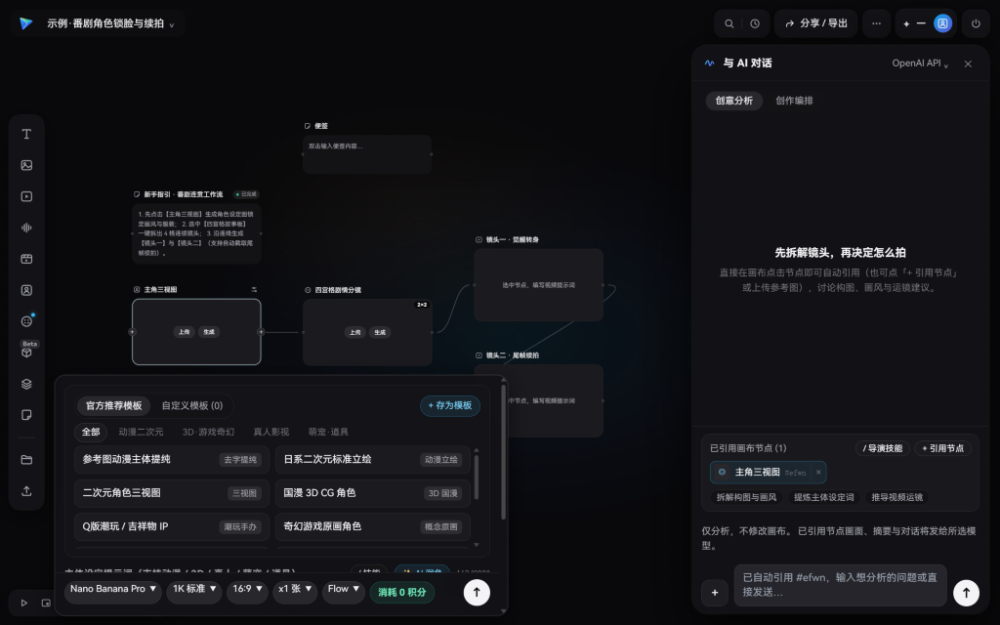
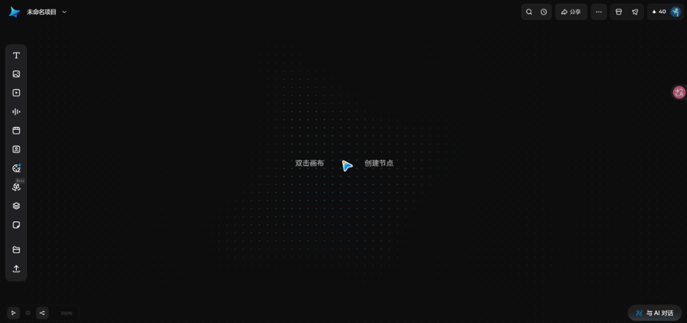
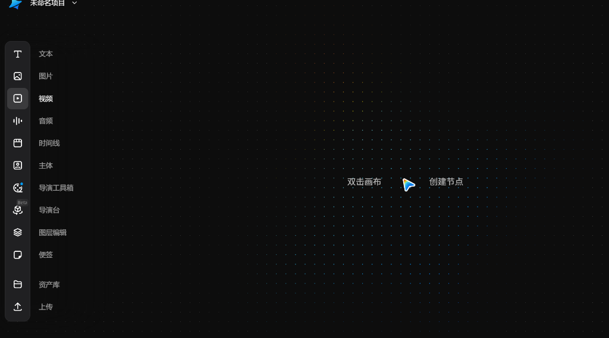
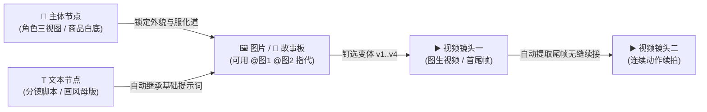
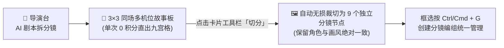
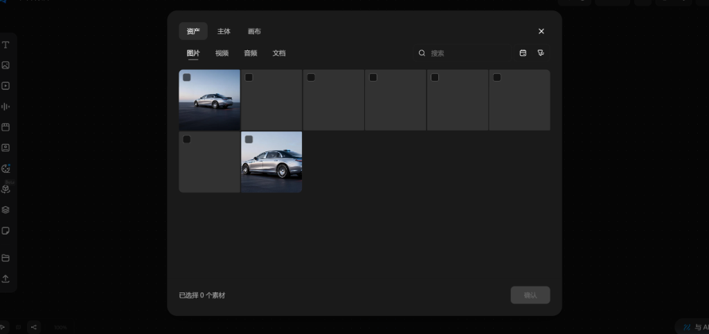

  
  <h1>AI Canvas Studio 创作者使用手册</h1>
  
<strong>无限画布 × 导演分镜工作流全指南（对标即梦 AI 无限画布 &amp; LibTV 影视创作范式）</strong>

  
适用人群：AI 漫剧 / 真人短剧导演 · 视觉分镜师 · 商业广告 TVC 创作者 · 电商视觉设计师

---

## 目录

1. [为什么用「无限画布 + 节点工作流」做片子？](#1-为什么用无限画布--节点工作流做片子)
2. [3 分钟极速开局（安装、账号配对与首条样片）](#2-3-分钟极速开局安装账号配对与首条样片)
3. [工作台五区全景导览（界面速查图解）](#3-工作台五区全景导览界面速查图解)
4. [六大核心节点与「万物互联」连线法则](#4-六大核心节点与万物互联连线法则)
5. [五大影视级实战工作流 SOP（从剧本到成片）](#5-五大影视级实战工作流-sop从剧本到成片)
   - [SOP 01｜漫剧 / 短剧：角色三视图锁脸与多镜一致性续拍](#sop-01漫剧--短剧角色三视图锁脸与多镜一致性续拍)
   - [SOP 02｜AI 导演台：剧本一键拆分镜 + 3×3 多机位无损切分](#sop-02ai-导演台剧本一键拆分镜--33-多机位无损切分)
   - [SOP 03｜高阶动态运镜：首尾帧锁定、尾帧无限续拍与爆款拉片复刻](#sop-03高阶动态运镜首尾帧锁定尾帧无限续拍与爆款拉片复刻)
   - [SOP 04｜零积分后期精修：❖ 图层画板（重绘 / 消除 / 扩图 / 拼贴融合）](#sop-04零积分后期精修-图层画板重绘--消除--扩图--拼贴融合)
   - [SOP 05｜声画成片交付：ılı 声画导演 + 时间线导出 MP4 + `.huabu` 配方分享](#sop-05声画成片交付ılı-声画导演--时间线导出-mp4--huabu-配方分享)
6. [模型选型与积分省钱精算表（必看）](#6-模型选型与积分省钱精算表必看)
7. [斜杠导演技能 `/` 与效率快捷键速查](#7-斜杠导演技能--与效率快捷键速查)
8. [常见问题与排障指南（FAQ）](#8-常见问题与排障指南faq)

---

## 1. 为什么用「无限画布 + 节点工作流」做片子？

传统网页端「单点对话框抽卡」做短剧或广告时，最大的痛点是**角色容易崩脸、前后光影割裂、历史资产散落各处难以回溯**。

**AI Canvas Studio** 采用与 **即梦 AI 无限画布** 及 **LibTV** 一脉相承的 **空间化节点连线范式**：

- **空间化全局统筹**：把「剧本大纲 → 主角定妆照 → 核心道具 → 九宫格分镜 → 多镜头动态视频」平铺在同一张纯黑无界画布（`#09090b`）上，全片叙事脉络一目了然。
- **连线即继承，锁脸不崩坏**：只要从「主体」节点拉一条线连向任意分镜或视频节点，主角五官、发色、服饰纹章自动作为参考锚点注入底层生成引擎。
- **单点微调，无损回溯**：第 3 镜不满意？直接重跑或用图层画板局部涂抹修改第 3 镜即可，每个节点自动保留最近 **10 个历史版本**（`< 第 1/N 版 >` 随时秒切），绝不牵连前后镜头。
- **本地优先 + 自带账号（BYOA）隐私安全**：所有画布数据库、高清原图原片与账号会话均 100% 存储在你自己的电脑本地，零云端中转泄密风险。

  

---

## 2. 3 分钟极速开局（安装、账号配对与首条样片）

### 第一步：启动工作台
- **普通创作者（免环境）**：
  - **安装版**：运行 `AI-Canvas-Studio-v*-win64-setup.exe`，双击桌面快捷方式启动。
  - **绿色便携版**：解压 `Portable.zip`，双击 `AI-Canvas-Studio.exe` 即可运行（画布数据保存在同级 `data/` 目录，拷入移动硬盘即可换电脑接着做）。
- **开发者源码启动**：双击仓库根目录 `启动画布.vbs` 或运行 `start-desktop.cmd`。

### 第二步：绑定 Google Flow 创作账号（仅首次需 30 秒）
1. 点击画布右上角的 **账号胶囊**（`✦ —` + 圆形头像）→ 展开 **「Flow 账号与积分」**。
2. 新建一个账号标签（如 `主力 Ultra`），选择你的订阅档位（`Ultra` 或 `Pro`），点击 **「打开连接向导 / 立即登录」**。
3. 在自动弹出的正版 Chrome 伴侣窗口中登录你的 Google Flow 账号（`https://flow.google.com/`），并**点开任意一个已有或新建的 Flow 项目**。
4. 系统检测到项目地址后会自动完成配对绑定，并将伴侣窗口最小化转入后台静默运行，右上角亮起绿点并同步实时积分余额。

> [!TIP]
> **可选进阶配置（开启 AI 润色与剧本拆镜）**：点击右上角 `···`（更多）→ **「AI 模型与提供商」**，填入你自己的 OpenAI 兼容接口（如 DeepSeek / 硅基流动 / OpenRouter / GPT）或 Gemini API Key，即可解锁画布内的 **「✨ AI 润色」**、**「AI 剧本拆分镜」** 与 **「与 AI 对话」** 视觉分析能力。即使暂不配置 LLM，所有生图、生视频与图层编辑功能依然完全可用！

### 第三步：一键体验内置样片工作流
空白画布正中央内置了 **3 套开箱即用的行业标准工作流卡片**：
- **动漫漫剧**：《番剧角色锁脸与多镜续拍》
- **真人短剧**：《真人短剧定妆锁脸与情绪运镜》
- **电商广告**：《核心产品锚定与商业广告大片》

直接点击任一卡片，系统将自动在画布上铺开完整节点拓扑、连线关系与标准中文提示词，选中第一个节点按回车即可开始出片！

  

---

## 3. 工作台五区全景导览（界面速查图解）

工作台摒弃了遮挡画面的固定侧边栏，采用全屏无边框沉浸画布 + **五大毛玻璃悬浮功能岛**：

| 区域 | 名称 | 核心功能说明 |
| :--- | :--- | :--- |
| **左上角** | **项目与画布胶囊** | 点击当前画布名可 **新建画布、重命名、切换历史画布、删除画布**，或直接导入/导出 `.huabu` 工作流配方包。 |
| **左侧中部** | **垂直导演工具坞** | 默认 `44px` 极简纯图标轨，鼠标移入平滑浮现中文标签（零画面抖动），上区 10 项创作与导演工具 + 下区「资产库」与「上传」。 |
| **右上角** | **全局控制与账号胶囊组** | 依次包含：`🔍 节点快速检索` · `🕒 任务队列与历史记录` · `↗ 分享/导出` · `··· 更多设置（LLM 配置 / Flow 项目 / 快捷键 / 检查更新）` · `✦ 积分与账号状态` · `⏻ 关闭本地服务`。 |
| **左下角** | **视口与预演控制条** | `▷ 全局序列预览` · `⊡ 深色迷你小地图 & 一键适应视口` · `连线显隐开关（审片更清爽）` · `缩放比例菜单（50% / 100% / 200%）`。 |
| **右下角** | **「与 AI 对话」副驾驶** | 默认收起为轻量胶囊；点击展开右侧毛玻璃抽屉，支持 **`创意分析`**（纯视觉拉片拆解，绝不改画布）与 **`创作编排`**（自动建点连线生图）双模式切换。 |

### 左侧导演工具坞 12 项工具逐一详解

  

1. **`T` 文本**：创建提示词/分镜脚本节点，下游连线图片或视频节点可自动继承文本内容。
2. **`🖼️` 图片**：创建生图节点（支持纯文生图、单图精修与最多多路参考图融合生图）。
3. **`▶️` 视频**：创建视频节点（自动识别纯文生视频、单图/多变体图生视频、Omni 多图参考生视频、首尾帧锁定）。
4. **`ılı` 音频**：打开 **声画导演** 弹窗，编排角色口型台词、拟音环境音效与本地 BGM 配乐轨。
5. **`🎞️` 时间线**：打开 **时间线剪辑与合成导出器**，自由调整镜头顺序、剔除废片、设置单镜时长并一键浏览器原生合成导出完整视频。
6. **`👤` 主体**（含子入口 **物品素材**）：创建角色定妆锚点或核心商品/道具参考节点，内置 11 套官方分类模板。
7. **`🎨` 导演工具箱**：创建 **故事板（Storyboard）** 节点，单图直出 `2×2`（4 格）、`2×3`（6 格）、`2×4`（8 格）或 `3×3`（9 宫格）连续剧情或同场多机位画面。
8. **`🧊` 导演台 `Beta`**：唤起 **AI 导演台** 大弹窗，提供「📜 AI 剧本拆分镜铺流」与「🎬 爆款视频抽帧拉片复刻」。
9. **`❖` 图层编辑**：对当前选中图片节点开启交互式画板（画笔局部重绘、一键消除笔、比例扩图、多节点拖拽拼贴光影融合）。
10. **`🗒️` 便签**：在画布任意位置添加导演批注、场记说明或灵感备忘（不参与下游提示词污染）。
11. **`📁` 资产库**：打开居中三合一资产库模态框（`资产` / `主体` / `画布`），支持 6 列网格批量勾选一键铺入当前画布。
12. **`↑` 上传**：从本机选择 PNG / JPG / WebP / GIF 参考图（桌面端采用独立 Win32 进程选图，绝不卡死窗口），自动在视口中央生成素材节点。

---

## 4. 六大核心节点与「万物互联」连线法则

在画布上创建节点有 **3 种最快手势**：
- **双击画布空白处**：直接在鼠标落点弹出「创建节点」毛玻璃菜单。
- **拖拽连线松开在空白处**：从任意节点右侧圆点（输出锚点）拖出连线松手，自动弹出「连接至新节点」菜单并完成自动连线。
- **点击左侧工具坞图标**：在当前视口空闲位置智能无重叠落点创建。

### 四大黄金连线机制

1. **多变体按边钉选（`v1 ~ v4`）**：
   - 当上游图片节点一次抽卡生成了 4 张变体时，你可以在连线上或下游节点的「已连线上游参考」缩略图上点击 `v1` 切换为 `v2 / v3 / v4`。**不同下游分支可以分别绑定不同变体**，实现一图多线对比推演。
2. **`@图1`、`@图2` 位置与角色精准指代**：
   - 当一个节点连入了多个上游参考（例如：`@图1` 男主、`@图2` 女主、`@图3` 咖啡馆场景），在提示词框输入 `@` 即可弹出快捷点选条。写出如：`@图1 坐在左侧微笑递出信封，@图2 站在右侧惊讶接过，背景为 @图3 的复古窗边`，底层会自动映射为精准位置锚点，彻底告别男女主串脸！
3. **视频连视频 / 图片自动抽帧缓存**：
   - 将上游 **视频节点** 连向下游 **视频** 或 **图片** 节点时，下方控制栏会出现 **「尾帧续接（默认） / 首帧参考」** 切换器。提交时浏览器会自动无损截取该视频最后一帧上传为高清参考图并缓存，实现一镜到底的丝滑续拍。
4. **防误扣费人工确认门禁**：
   - 点击 **「✨ AI 润色」** 或在右侧 AI 对话中使用生视频规划时，系统**绝不会擅自扣除你的视频积分**——所有 AI 生成的提示词都会先填入输入框并点亮「确认生成」提示条，不满意随时点 **「↩ 还原原词」** 一键撤回。

---

## 5. 五大影视级实战工作流 SOP（从剧本到成片）

### SOP 01｜漫剧 / 短剧：角色三视图锁脸与多镜一致性续拍

> **适用场景**：制作 1~3 分钟连载二次元番剧、3D 国漫或真人短剧，要求主角在十几个不同景别与情绪镜头中五官、发型、服饰 100% 统一。

1. **创建定妆主体**：双击画布新建 **「主体」** 节点，在上下文控制栏顶部的 **「官方推荐模板」** 中按风格点选：
   - 动漫番剧选 **`二次元角色三视图`** 或 **`日系二次元标准立绘`**（已有草图去字选 **`参考图动漫主体提纯`**）；
   - 3D 漫剧选 **`国漫 3D CG 角色`**；真人短剧选 **`影视写实人物定妆`** 或 **`东方古风侠客主体`**。
2. **补充角色特征并出图**：在模板后追加角色专属特征（如发色、瞳色、标志性配饰），画幅选 `16:9`（三视图）或 `9:16`（立绘），模型选 `Nano Banana Pro`（0 积分），点击 `↑` 生成。若经常复用该主角，可点右上角 **`+ 存为模板`** 永久保存在自定义模板库，或存入 **「资产库 → 主体」** 跨项目随取随用。
3. **多镜头扇出连线**：从「主体」节点右侧拖出多条连线，分别新建镜头 1、镜头 2、镜头 3 的 **「图片」** 节点。由于本工作台已内置**影视叙事自适应引擎**，在输入诸如 *“雨夜过肩特写，主角眼含泪光侧脸对峙”* 时，系统会自动解锁电影感景别与戏剧化表情，不会呆板地直视镜头。
4. **单图快捷衍生**：选中任意已生成的分镜图，卡片上方悬浮工具栏支持一键触发 **`⏮ 前一幕`**、**`⏭ 下一幕`**、**`🎥 换机位`**、**`💡 重打光`** 与 **`🔍 2K 超清`**，几秒内铺满整场戏的反应镜头与正反打！

---

### SOP 02｜AI 导演台：剧本一键拆分镜 + 3×3 多机位无损切分

> **适用场景**：手里只有一段小说/故事文案，或想围绕同一场戏一次性拍出远景、中景、特写、俯仰拍等 9 个标准电影机位后再挑镜头生成动态视频。

**路径 A：AI 剧本一键拆镜铺流**
1. 点击左侧工具坞 **`🧊 导演台`**（或在输入框敲 `/剧本拆分镜`）。
2. 粘贴你的故事梗概或广告脚本，选择期望镜头数（`3 镜 / 4 镜 / 6 镜`）与画幅（`16:9` 或 `9:16`），点击智能拆解。
3. 预览确认各镜景别与提示词后一键铺入画布，系统自动排布好「主体 → 分镜图 → 下游视频草稿」全套节点树。

**路径 B：3×3 同场多机位九宫格 + 一键无损切分（强烈推荐省分神技！）**
1. 从「主体」节点拖线新建 **「故事板」** 节点。
2. 在参数栏将分镜宫格设为 **`9 格 (3×3)`**，分镜模式切换为 **`同场多机位`**（也可点 `/ 技能` → `/多机位九宫格`），模型选用空间逻辑极强的 **`Nano Banana 2.1`（思考深度：高）**。
3. 生成后你将得到一张同一时空、同一光影下的 9 机位电影联系表（远景、中景、正特写、侧 45°、过肩、仰拍、俯拍、手部细节、背影）。
4. 点击该故事板卡片顶部的 **「✂ 切分宫格」** 按钮，系统将在浏览器本地**无损等分裁切**并自动上传生成 9 个独立的图片节点整齐排布在右侧！挑出最惊艳的 3~4 个机位连入视频节点即可，零废片、零画风漂移！
5. 按住 `Shift` 框选同场节点后按 **`Ctrl / Cmd + G`**，即可创建带色标的 **分镜编组**，整场戏一起拖拽或单独导出。

---

### SOP 03｜高阶动态运镜：首尾帧锁定、尾帧无限续拍与爆款拉片复刻

> **适用场景**：需要角色从 A 姿态精准过渡到 B 姿态（如变身、转身拔剑、产品开箱闭合），或复刻某条爆款短视频的镜头节奏。

1. **四种视频驱动模式自由切换**（选中视频节点即可见）：
   - **纯文生视频**：不连任何参考图直接输入描述，自动调用 Flow 原生文生视频通道，适合空镜与转场素材。
   - **首帧 / 多变体图生视频（Veo 3.1）**：连入 1 张含多变体的图片节点，可勾选任意几个变体批量并发生成 8 秒高清镜头。
   - **多图参考生视频（Omni 1.2 Flash）**：同时连入「角色主体 + 服装道具 + 场景图」，开放 **3–15 秒连续时长滑块**，配合 `@图1`、`@图2` 实现多元素动态交互。
   - **⇄ 首尾帧锁定**：当视频节点连入 **≥ 2 张上游参考图** 时，点选「视频驱动方式 → **`⇄ 首尾帧锁定`**」，分别指定 `首帧（Start）` 与 `尾帧（End）`（支持一键 `⇄ 互换`），精准锁死镜头的起点与落幅！
2. **电影级运镜与原生声画同步**：
   - **7 大运镜预设**：`固定机位`（电商防裁切首选）、`智能动态`、`缓慢推近`、`拉远全景`、`环绕跟拍`、`手持纪实`、`摇臂俯仰`。
   - **🎙️ 台词与音效输入槽**：展开提示词下方的「+ 台词与音效预设」，填入角色口型对白与环境音（如 *“细雨落瓦、低沉大提琴弦乐”*），直出声画口型同步片段。
3. **🎬 爆款视频拉片复刻**：
   - 打开左侧 **`🧊 导演台 → 爆款视频拉片复刻`**，拖入一条本地参考短视频，工作台会自动在本地按时间轴抽取关键帧并构建复刻连线流，换上你自己的「主体」即可快速复刻同款运镜节奏。

---

### SOP 04｜零积分后期精修：❖ 图层画板（重绘 / 消除 / 扩图 / 拼贴融合）

> [!IMPORTANT]
> **省钱秘籍**：图层画板内的所有编辑操作底层均调用 Google Flow 原生 `edit_image` 接口，**消耗 0 积分**！画面有小瑕疵千万别急着重跑视频，先用图层画板修完美再进视频节点。

选中画布上任意已生成的图片节点，点击左侧工具坞 **`❖ 图层编辑`**（或节点快捷编辑入口），即可进入四大精修模式：

1. **🖌️ 局部重绘（Inpaint）**：调节画笔粗细涂抹需要修改的区域（如给角色换一副眼镜、修改手部动作、把手中咖啡换成宝剑），输入修改指令一键无痕替换，未涂抹区域像素级锁定。
2. **🧹 一键消除笔（Erase）**：涂抹画面中多余的路人、穿帮杂物或意外出现的文字水印，无需写复杂提示词，一键干净抹除并智能补全背景纹理。
3. **🖼️ 比例扩图（Outpaint）**：支持将 `9:16` 竖图无损扩展为 `16:9` 电影横屏（或 `1:1`、`1.4x` 四周扩景），AI 自动延展环境透视与光影。
4. **🧩 多图拼贴光影融合（Collage Fusion）**：将画布上其他角色或道具节点直接拖入画板自由摆放缩放位置，一键执行光影与透视融合，轻松搞定复杂的多人同框站位构图！

---

### SOP 05｜声画成片交付：ılı 声画导演 + 时间线导出 MP4 + `.huabu` 配方分享

1. **ılı 声画导演**：点击左侧工具坞「音频」，可统一规划各镜头的人声情绪音色、对白台词、拟音音效，并导入本地配乐音轨（BGM）。
2. **🎞️ 时间线一键合成导出**：
   - 点击左侧工具坞「时间线」（或左下角 `▷` 按钮），工作台会自动收集当前画布上的有效镜头。
   - 你可以拖拽重排镜头先后顺序、勾选剔除备选废片、调节图片镜头的停留秒数，实时全屏预演整片节奏，最后点击 **「导出成片」** 在纯浏览器本地直接合成下载完整成片视频！
3. **📁 全局资产库沉淀与 `.huabu` 配方分享**：
   - 满意的角色与分镜可在预览窗一键收藏至 **「资产库」**（支持 `[资产] · [主体] · [画布]` 分类检索与 6 列多选批量上画布）。
   - 点击右上角 **`↗ 分享 / 导出`**，可将整张画布打包为单个 `.huabu` 工作流文件（可选「携带本地素材完整包」或「纯参数轻量包」）。**系统会自动剥离你的账号、Project ID、API Key 与聊天记录**；团队伙伴收到后只需把 `.huabu` 文件直接拖进画布，系统便会自动同步参考素材并完美复现整套创作流！

  

---

## 6. 模型选型与积分省钱精算表（必看）

每次生成前，生成控制栏底部都会实时展示 **预估消耗积分胶囊** 与 **当前账号积分余额**（点击余额胶囊可手动刷新同步）。

### 6.1 图像生成与超清重塑模型（全系 0 积分）

| 模型名称 | 定位标签 | 积分消耗 | 核心优势与最佳适用场景 |
| :--- | :--- | :---: | :--- |
| **Nano Banana Pro** | 旗舰主力 · 长期推荐 | **0 积分** | 写实皮肤肌理、商业棚拍质感、**中文海报汉字排版**与局部重绘精修首选。 |
| **Nano Banana 2.1** | 可调思考深度（标准/低/中/高） | **0 积分** | 空间逻辑与复杂构图理解最强，强烈推荐用于 **`3×3` 九宫格分镜**与多人互动站位。 |
| **Nano Banana 2 Lite** | 极速轻量 | **0 积分** | 出图极快，适合前期灵感草图与 x4 张批量抽卡试构图。 |

- **清晰度说明**：`1K 标准` 原生极速直出；`2K 高清` 生成后自动调用官方 SPrCad 超清重塑（Free/Pro/Ultra 均可用，0 额外积分）；`4K 超清` 为 Ultra 专属超分（0 额外积分）。

### 6.2 视频生成模型与官方积分计费矩阵

| 模型名称 | 支持时长 | 原生分辨率 | Ultra 积分/条 | Pro / 其他积分/条 | 最佳适用场景 |
| :--- | :---: | :---: | :---: | :---: | :--- |
| **Omni 1.2 Flash（360p 草稿）** 💡 | **3–15 秒连续可调** | 360p | **1–10s：1 积分/秒** **11–15s 超出部分：2 积分/秒** *(8s=8, 10s=10, 15s=20)* | **同左** *(3–10s 全员；11–15s 需付费)* | **极省积分试动作/拉片草稿**（仅为 720p 的 1/3 成本），满意后再升清。 |
| **Omni 1.2 Flash（720p 标准）** ⭐ | **3–15 秒连续可调** | 720p | **1–10s：3 积分/秒** **11–15s 超出部分：6 积分/秒** *(8s=24, 10s=30, 15s=60)* | **同左** *(3–10s 全员；11–15s 需付费)* | **多参考图锁脸合拍**、任意时长卡点短片、声画台词同步首选。 |
| **Veo 3.1 - Lite** ⭐ | 8 秒固定 | 720p | **5 积分** | **10 积分** | 日常单图生视频主力，速度稳、性价比最高，官方长期保留型号。 |
| **Veo 3.1 - Lite [Lower Priority]** 🔥 | 8 秒固定 | 720p | **0 积分（免费！）** | *仅限 Ultra* | **Ultra 会员专属省分神器**：低优队列闲时极快，适合批量抽卡、空镜与测试动作！ |
| **Veo 3.1 - Fast** *(12/5 停用)* | 8 秒固定 | 720p | **10 积分** | **20 积分** | 高画质快速验证复杂物理运动与光影变化。 |
| **Veo 3.1 - Quality** *(12/5 停用)* | 8 秒固定 | 720p | **100 积分** | **100 积分** | 终版重头戏特写、复杂流体水火、丝绸飘动与电影级精修镜头。 |

#### 高清超分附加费（`UPSAMPLE_VIDEO`，在上方基础生成费之外另计）

| 目标分辨率 | 会员权限 | 1–10 秒视频附加费 | 超过 10 秒部分（11–15 秒） | 省分建议 |
| :--- | :---: | :---: | :---: | :--- |
| **1080p 超分** | Plus / Pro / Ultra | **+0 积分（免费）** | **+1 积分 / 秒** *(如 15s = +5 分)* | 10 秒内短片可放心直接升 1080p。 |
| **4K 超清重塑** | **仅限 Ultra** | **+50 积分 / 条** | **+5 积分 / 秒** *(如 15s = +75 分)* | **切忌批量 x4 抽卡时直选 4K！** 建议先用 `360p/720p` 抽卡挑出最满意的 1 条，再在预览窗单独点击「✨ 4K 超清」。 |

---

## 7. 斜杠导演技能 `/` 与效率快捷键速查

### 7.1 输入框 `/` 斜杠导演技能（提示词栏与 AI 对话框通用）
在任意节点提示词框或右下角「与 AI 对话」输入框中敲入 **`/`**（或点击 **`/ 技能`** 按钮），即可快速唤出 5 大导演预设：

| 斜杠指令 | 技能名称 | 触发效果 |
| :--- | :--- | :--- |
| **`/剧本拆分镜`** | AI 剧本拆分镜铺流 | 直接打开 AI 导演台「剧本拆镜」面板，将文字脚本转化为画布节点组 |
| **`/爆款拉片复刻`** | 参考视频抽帧拉片复刻 | 打开 AI 导演台「视频拉片」面板，抽帧拆解本地参考短视频并搭建复刻流 |
| **`/多机位九宫格`** | 同场多机位 3×3 九宫格 | 一键注入锁定人物光源的 9 景别电影联系表标准提示词 |
| **`/剧情推演`** | 连续动作推演下一幕 | 注入延续参考图服化道、推演 3 秒后戏剧动作的胶片感提示词 |
| **`/电影级打光`** | 电影级重打光氛围锁定 | 注入伦勃朗侧光、发丝轮廓高光与丁达尔体积光重塑指令 |

### 7.2 画布高频快捷键速查表

| 快捷键 / 手势 | 功能说明 |
| :--- | :--- |
| **`双击画布空白处`** | 在光标处就地弹出「创建节点」快捷菜单 |
| **`拖出节点连线松手`** | 在落点弹出下游节点菜单并自动完成连线 |
| **`G`** | 对当前选中节点打开完整生成参数对话框 / 查看大图结果 |
| **`L`** | 一键打开 / 关闭居中「资产库」模态框 |
| **`Ctrl / Cmd + G`** | 将框选的多个节点合并为一个带标题与色标的「分镜编组」 |
| **`Enter`（图片/文本节点）** | 在上下文生成栏内直接提交生图或保存文本（`Shift + Enter` 换行） |
| **`Ctrl / Cmd + Enter`（视频节点）** | 确认当前 Flow 账号与积分预估后提交视频生成（防误触回车扣费） |
| **`Delete` / `Backspace`** | 删除画布上选中的节点或连线（输入框聚焦时正常删字不误删节点） |
| **`ESC`** | 依次关闭当前打开的变体选择器、快捷菜单、资产库或模态弹窗 |

---

## 8. 常见问题与排障指南（FAQ）

**Q1：右上角提示「尚未配置有效套餐等级」或视频模型里 Ultra 0 积分选项置灰怎么办？**
- 点击右上角头像胶囊 → 展开 **「Flow 账号与积分」**，将当前账号的套餐等级切换为你实际的订阅档位（`Pro` 或 `Ultra`）即可立即解锁对应模型与精确积分估算。若未创建多账号配置，也可在根目录 `.env` 中设置 `FLOWBOARD_PAYGATE_TIER=PAYGATE_TIER_TWO`（Ultra）或 `PAYGATE_TIER_ONE`（Pro）。

**Q2：为什么桌面端点击登录会弹出一个独立的 Google Chrome 窗口，而不是内嵌小网页？**
- Google 官方安全策略会拦截内嵌 WebView 的账号登录（报错 `signin/rejected`）。因此 AI Canvas Studio 采用了 **正版 Chrome 独立配置目录伴侣引擎**：每个 Flow 账号拥有完全隔离的本地浏览器目录，支持多开切换互不串号，配对成功后会自动最小化到后台静默执行签名与生成任务。

**Q3：把别人分享的 `.huabu` 配方包拖进我的画布，或者从资产库跨画布复用角色图，为什么能直接用？**
- 虽然 Google Flow 官方要求参考图 `mediaId` 必须归属于当前选中的 Flow 项目，但本工作台内置了 **跨项目素材静默同步缓存（`MediaProjectMapping`）**：首次生成时会自动将本地缓存的高清原图后台重传至你当前绑定的 Flow 项目并记录映射，后续复用毫秒级直通、无需手动重新上传。

**Q4：生成视频中途如果关闭或重启了软件，重启后会重复扣我一次积分吗？**
- **绝对不会**。本地后端在启动时内置了孤儿任务熔断保护机制：所有因进程中断遗留的未完成请求会被安全标记为中断状态，**绝不自动重放提交**，100% 杜绝后台重复扣费。你只需在历史记录中核对后手动决定是否重跑。

**Q5：如何备份或迁移我的全部画布、主体模板与高清成片？**
- **绿色便携版**：直接复制整个软件文件夹（所有数据均在同级 `data/` 目录下）即可完整迁移。
- **安装版**：数据默认保存在 `%APPDATA%\ai-canvas-studio\workspace-storage`；单个重点项目也随时可通过右上角 **`↗ 分享 / 导出`** 存为包含媒体素材的 `.huabu` 归档包永久备份。

**Q6：2K/4K 高清重塑时提示 `PUBLIC_ERROR_UNUSUAL_ACTIVITY`（Google Flow 安全风控）怎么办？**
- 这是 Google Flow 对高分辨率重塑接口（`SPrCad`）返回的服务端风控拦截，常见于代理 IP 评分偏低、刚出图立即连续重塑，或后台 Flow 标签页长时间未刷新。
- **解决方法**：
  1. 桌面端点击「右上角头像 → Flow 账号与积分 → 登录并绑定项目」打开伴侣 Chrome 页面（网页扩展版直接切到 Chrome 前台），手动刷新 `https://flow.google.com/` 并完成可能出现的安全验证；
  2. 更换干净稳定的网络节点，避免中途切换 IP 或短时间连续高频点击重塑；
  3. 生成图片时先选 **`1K 标准`** 出图，间隔几秒再单独点击 **`2K 重塑`**，或直接前往 Flow 网页端导出高清原图。
